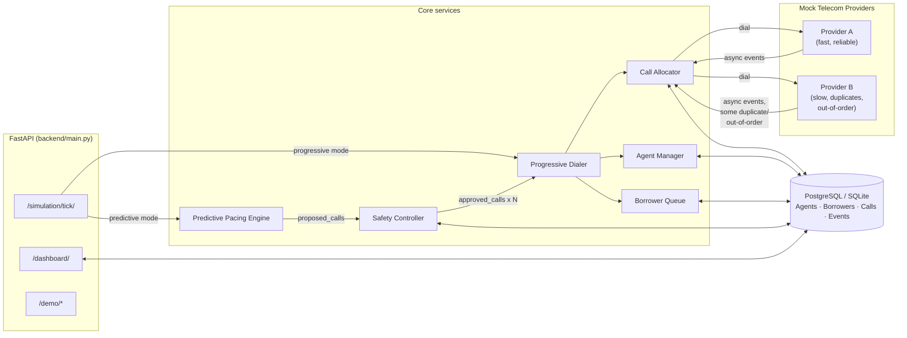
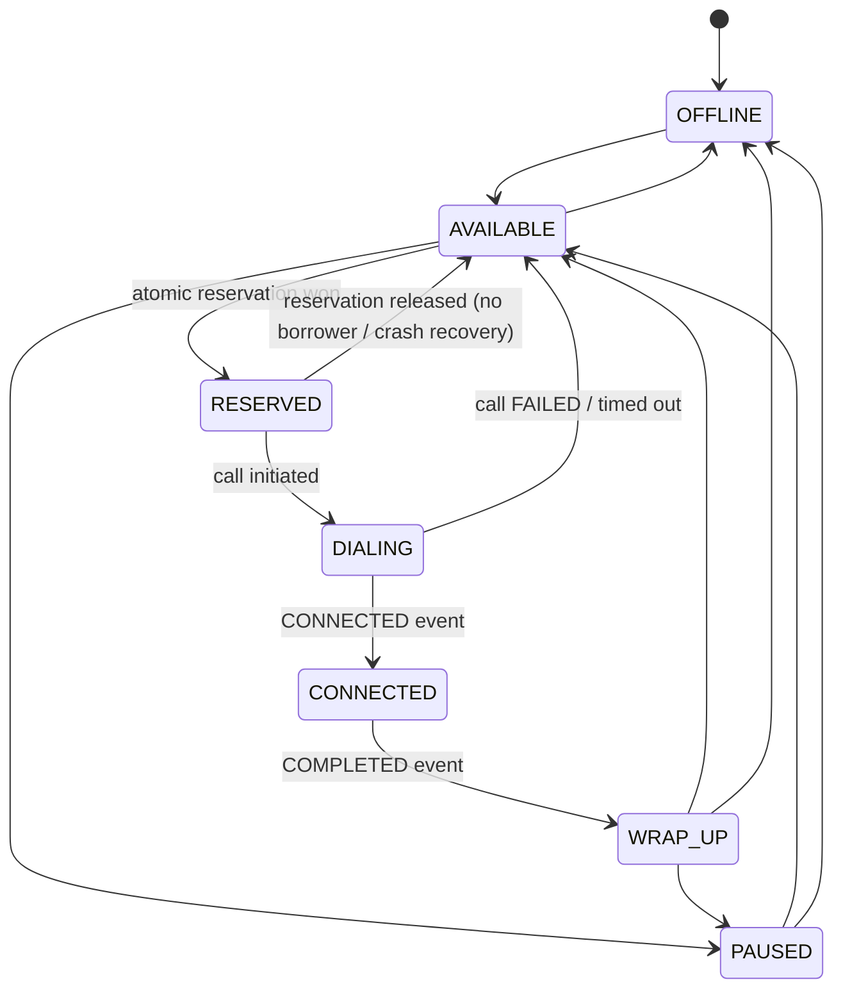
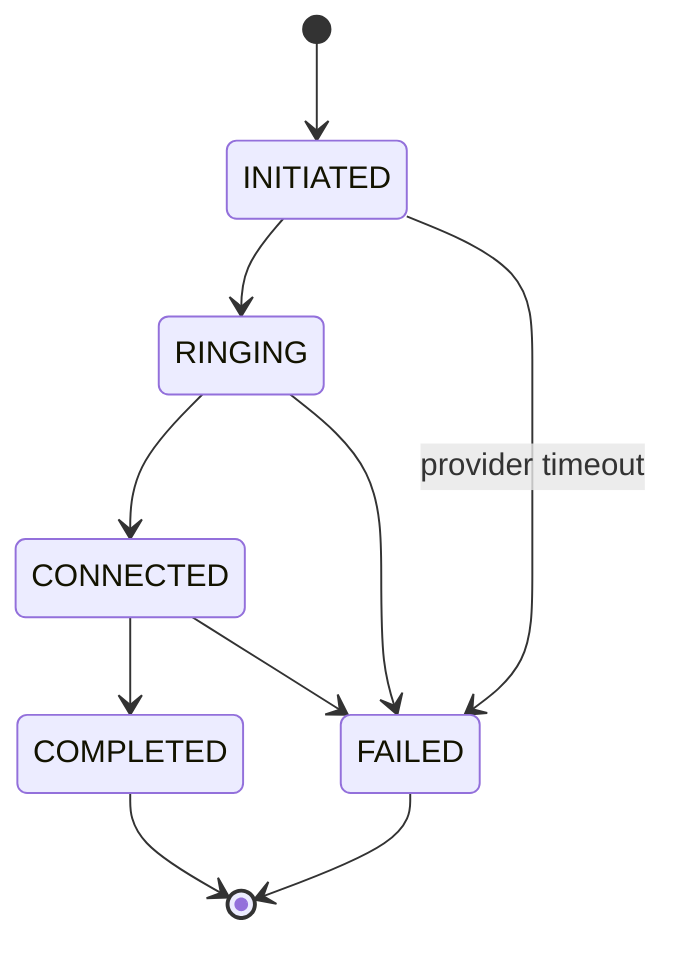

# SmartDialer — Architecture

## System overview



**Key separation of concerns (explicitly required by the assignment):** the
Predictive Pacing Engine only ever *proposes* a number. It has no access to
anything that initiates a call. The Safety Controller is the only component
that turns a proposal into `approved_calls`, and the only path from an
approved slot to an actual call is through the same `progressive_dial()`
function progressive mode uses directly — so predictive mode is implemented
as "run the guaranteed-safe progressive primitive N times," not as a
separate, parallel, less-trusted code path.

## Agent state machine



Every transition is validated against an explicit allow-list
(`AGENT_TRANSITIONS` in `backend/models.py`). There is no code path that sets
`agent.state` without going through `agent_manager.set_agent_state`, which
calls `validate_transition` first.

## Call state machine



Each state has a numeric **rank** (`CALL_STATUS_RANK`). An inbound event
whose target rank is **less than or equal to** the call's current rank is
dropped as stale/out-of-order — this is what protects a `COMPLETED` call from
being regressed by a late-arriving `RINGING` retry.

## Concurrency model

Two resources must never be double-allocated: **agents** and **borrowers**.
Both use the same pattern, implemented with a single conditional `UPDATE`
rather than `SELECT ... FOR UPDATE` (so it works identically on SQLite for
the prototype and PostgreSQL in production):

```sql
UPDATE agents SET state = 'RESERVED'
WHERE id = :id AND state = 'AVAILABLE';
```

The database guarantees this statement is atomic. If two workers race for
the same agent, exactly one `UPDATE` matches a row (`rowcount == 1`); the
loser sees `rowcount == 0` and tries the next candidate (or gives up). This
removes the SELECT-then-UPDATE race entirely — there is no window between
"read the state" and "write the new state" because they are the same
statement.

## Idempotency model

Every inbound provider event carries a provider-issued `event_id`. We keep a
`provider_events` table with a `UNIQUE(provider, event_id)` constraint and
**insert first, apply second**:

1. Attempt to insert the event record.
2. If the insert violates the unique constraint → it's a duplicate →
   ignored, call state untouched.
3. Otherwise, check the event's rank against the call's current rank
   (out-of-order protection) and the legal-transition table (illegal
   transition protection) before applying it.

This gives us three independent, composable guards over every single event:
**duplicate**, **stale/out-of-order**, and **illegal transition** — each
with its own test in `backend/tests/test_events.py`.

## Why Predictive mode is "progressive, N times" and not a separate dialer

A naive predictive dialer would reserve N agents/borrowers and start N calls
in one batch operation. We deliberately didn't build that. Instead,
`simulation_tick` calls `progressive_dialer.progressive_dial()` once per
approved slot. Benefits:

- The atomic single-agent reservation is exercised identically regardless of
  mode — there's only one way to reserve an agent in this codebase.
- If agents run out mid-batch (because other activity consumed them
  concurrently), the loop just stops early — no special-cased rollback logic
  needed for partial batches.
- Testing the one allocation primitive thoroughly covers both dialing modes.

## Provider health / forced Progressive Mode

The Safety Controller checks `provider_health` directly, independent of the
pacing proposal. When health drops below `PROVIDER_HEALTH_FORCE_THRESHOLD`
(0.4), predictive proposals are overridden to a maximum of 1 call — in
effect falling back to Progressive Mode without the caller needing to
switch modes explicitly. See `/demo/provider-outage`.
